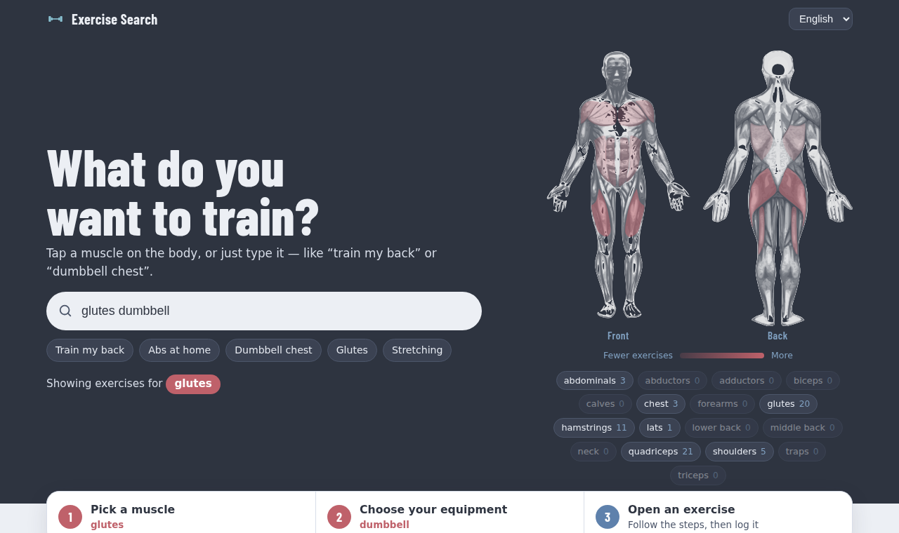
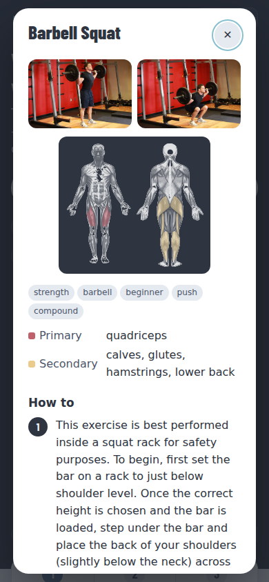

# Exercise Search

**Find the right exercise for the muscle you want to train.** Tap a muscle on the body map, or just type what you want — "train my back", "abs at home", "二の腕を引き締めたい", "想练臀部". 1,781 exercises with images, step-by-step instructions and muscle maps, in English, Japanese and Chinese. Free, no sign-up, no tracking, open data.

**▶ Try it: https://nebourocket.github.io/exercise-search/**



## How to use it

1. **Pick a muscle.** Tap it on the front/back body map, tap a muscle button, or type it in your own words. The map glows brighter where more exercises match, and the app shows which body part it understood.
2. **Choose your equipment.** Bodyweight, dumbbell, barbell, cable, machine, kettlebell, bands… each button shows how many exercises are left. You can also type it ("glutes dumbbell").
3. **Open an exercise.** See the start/end images, which muscles it works (red = primary, yellow = secondary), and the numbered steps. Tap **Log in PFC Calculator** to record your sets.

The three steps are shown on the page and light up as you go, so you always know what to do next.



## Features

- **Say it your way** — natural phrases in English, Japanese and Chinese are mapped to muscles (`I want to train my back`, `お腹を鍛えたい`, `太ももの裏`, `我想练背`). Exercises whose primary muscle matches come first.
- **Body heat map** — every muscle is shaded by how many exercises match your current search; hover to see the count, click to filter.
- **Three languages** — UI, exercise names and instructions in English / 日本語 / 中文 (Simplified). Translations are labeled "AI translation" and the English original is one tap away.
- **Guides for every exercise** — exercises that have no image or no written steps get a detailed guide (setup, steps, common mistakes), clearly labeled as AI-written.
- **Filters** — muscle, equipment, type, level, force, mechanic; optionally include secondary muscles.
- **Shareable links** — the URL keeps your search, filters, language and open exercise (`?q=squat&equipment=barbell&lang=ja&id=Barbell_Squat`).
- **Light and dark theme**, works on phones, no account and no analytics.
- **PFC Calculator link** — opens [PFC Calculator](https://nebourocket.github.io/pfc-calculator/) with the exercise name and muscle group filled in.

## How it works

A static site (HTML + CSS + vanilla JavaScript, no build step) hosted on GitHub Pages. All search runs in the browser:

| File | Contents |
| :--- | :--- |
| `data/exercises.json` | 876 exercises from free-exercise-db |
| `data/wger.json` | 905 exercises from the wger API (duplicates by name removed) |
| `data/guides.json` | AI-written guides (en / ja / zh) for exercises without images or text |
| `data/i18n.json` | Japanese and Chinese names and instruction translations |
| `assets/muscles/` | Body map SVGs (front, back, one layer per muscle) |
| `search.js` | Search, phrase-to-muscle mapping, PFC link (pure functions, tested in Node) |
| `app.js` | UI: body map hit-testing, heat map, flow steps, detail view |

Clicking the body map is hit-tested against the per-muscle layers themselves (the pixel under the cursor), so there are no hand-drawn click areas.

## Development

```bash
python3 -m http.server 8000      # then open http://localhost:8000
node tests/search.test.js        # search, phrase mapping, translation and PFC-link tests
bash tools/update_data.sh        # refresh data from free-exercise-db and the wger API
bash tools/build_muscles.sh      # refresh the body-map SVGs (recolored to Nord red / yellow)
```

## Data and licenses

- **Code** — MIT.
- **[free-exercise-db](https://github.com/yuhonas/free-exercise-db)** — `data/exercises.json` and its images, The Unlicense (public domain).
- **[wger](https://wger.de)** — `data/wger.json` and its images, via the official API. Each exercise is CC-BY-SA 3.0, CC-BY-SA 4.0 or CC0 as set by its author; the license and authors are shown on every exercise and stored in its `attribution` field. Shared under the same licenses. AI-generated images are excluded.
- **Guides** (`data/guides.json`) — written by AI from each exercise's name, equipment, muscles and original wger description, for every exercise that has no image or no written steps (691). Where the original has no usable instructions, a note at the top of the guide says what it is based on and what is unconfirmed. Every guide was cross-reviewed by two AI model families (Claude and GPT) against the original description, with safety taking priority. CC-BY-SA 4.0.
- **Translations** (`data/i18n.json`, and the Chinese guides) — machine-translated by AI (GPT), then every item was checked step by step against the English original by a second AI (Claude) and corrected (grips, left/right, merged steps, units). Same licenses as the source text.
- **Body map** (`assets/muscles/`) — [Muscular_system.svg](https://commons.wikimedia.org/wiki/File:Muscular_system.svg) and [Muscular_system-back.svg](https://commons.wikimedia.org/wiki/File:Muscular_system-back.svg) by Termininja (Wikimedia Commons), split into per-muscle layers by the [wger project](https://github.com/wger-project/wger) and recolored here. CC BY-SA 3.0.

The AI-written guides and translations may contain mistakes. If you spot one, please open an Issue or a PR — corrections are very welcome. Thank you to free-exercise-db, wger and all their contributors!

## Notes for contributors and AI agents

- Do not edit `data/exercises.json` or `data/wger.json` by hand; regenerate them with `tools/update_data.sh`. Never scrape other sites.
- Do not generate exercise images with AI — a wrong form picture can cause injury. Keep the "Written by AI" and "AI translation" labels and the English original.
- Keep the source, license and author credit (`attribution`) on every wger exercise.
- Translations must keep the same number and order of steps as the English original (the app falls back to English if they differ).
- The body map hit-testing uses the muscle layers; do not hand-draw click areas. Refresh the SVGs with `tools/build_muscles.sh`.
- Phrase-to-muscle search lives in `search.js` (`SYNONYMS` maps words to muscles, `INTENT_PATTERNS` lists filler phrases to ignore). Add a test in `tests/search.test.js` for every new phrase.
- PFC Calculator link: `search.js` (`PFC_MUSCLE`, `pfcUrl`) sends `?exercise=<name, max 40 chars>&muscle=<胸|背中|脚|肩|腕|腹|その他>`; the receiver is `app.js` in [nebourocket/pfc-calculator](https://github.com/nebourocket/pfc-calculator). Change both together.
- Work through Issue → branch → PR → merge, and run `node tests/search.test.js` first.
